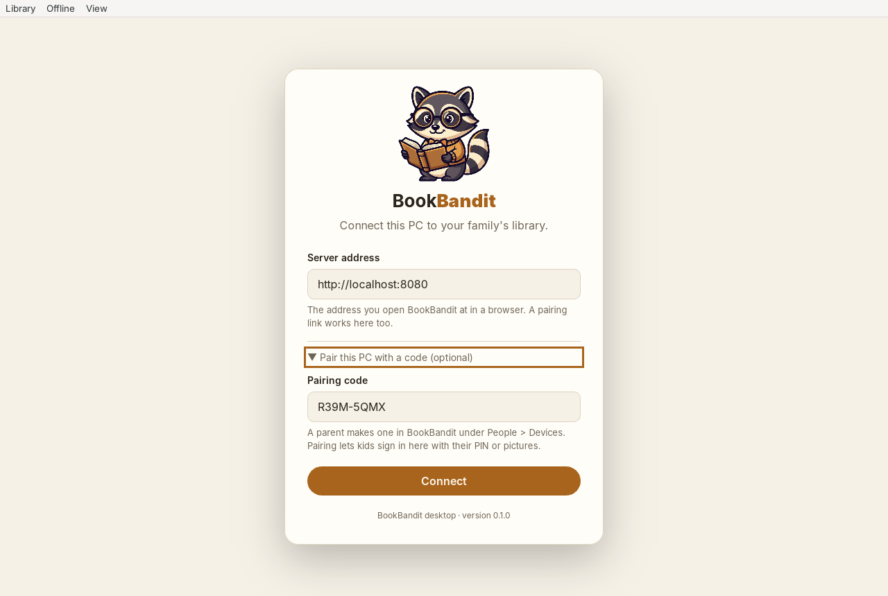

# BookBandit for Windows

A small Tauri 2 app that opens your family's BookBandit server in its own window, and keeps books
on the PC for reading without internet.



## How it works

- **The window shows the server.** After setup the app loads the server's own web app, so sign-in
  (password, Google through Tinyauth, kid PIN/pictures), the content lock and every feature come
  from the server, exactly as in a browser. Server pages get no access to the native side.
- **Setup and pairing.** First run asks for the server address. Optionally paste the pairing link
  (`bookbandit://pair?server=…&code=…`) or type the code a parent made under People > Devices; the
  app claims it (`POST /api/devices/claim`) and stores the device token as the `bb_device` cookie,
  so the PC is a paired family device, just like a tablet. Library > Change server... redoes setup.
- **Offline.** On a book's page or in the reader, Offline > Save this book for offline (Ctrl+S)
  downloads the best readable file (EPUB, AZW3, MOBI, FB2, CBZ, PDF), the cover and the current
  position, using the window's own sign-in. Offline > Offline library (Ctrl+O) reads them with
  foliate-js. If the server can't be reached at start, the app offers the offline library.
- **Sync.** Positions read offline are queued and sent with `POST /api/progress/batch` the next
  time a server page loads (or Offline > Sync now). Newer positions from other devices come back.
- **Content lock offline.** Each saved copy remembers who saved it, and the offline library only
  lists the books saved by the person who was signed in last. Every sync re-checks each saved
  book with the server and deletes it if the server now says 404 (re-rated, removed, locked).

Files live in `%APPDATA%\app.bookbandit.desktop` (settings) and
`%LOCALAPPDATA%\app.bookbandit.desktop\offline` (books and `index.json`).

## Develop

Needs Rust (stable) and, on Linux, the WebKitGTK dev packages
(`libwebkit2gtk-4.1-dev librsvg2-dev`). Windows uses the built-in WebView2.

```sh
pnpm install
pnpm --filter @bookbandit/desktop tauri dev      # app window, with the pages hot-reloading
pnpm --filter @bookbandit/desktop dev            # just the pages in a browser, with a mock (?mock=first-run|offline|empty)
pnpm --filter @bookbandit/desktop test           # page helpers
cargo test --manifest-path apps/desktop/src-tauri/Cargo.toml
pnpm --filter @bookbandit/desktop tauri build    # installer (NSIS .exe and .msi on Windows)
pnpm --filter @bookbandit/desktop icons          # regenerate icons from the web app's Barnaby
```

## Releases

`.github/workflows/desktop.yml` builds on `windows-latest`. Pull requests that touch
`apps/desktop` get the installer as a run artifact. A `v*.*.*` tag builds
`BookBandit-<version>-windows-x64-setup.exe` and `.msi` and attaches them to that tag's GitHub
Release (it waits for the Docker workflow to create the release page). Run it by hand with a tag
to attach installers to an existing release.

The installers aren't code-signed yet, so Windows SmartScreen shows "Windows protected your PC"
the first time: choose More info > Run anyway. The installer is per-user (no admin rights) and
installs WebView2 if it's missing.

## Known limits

- Google may refuse to sign in inside an embedded window ("This browser or app may not be
  secure"). Use pairing or a password on the PC instead.
- Bookmarks and highlights made offline aren't saved yet; reading positions are.
- PDFs open in the web view's built-in viewer offline, and their position isn't tracked offline.
- Kid-safe lock (stop a kid using Change server or the menu) is not done; Android's settings lock
  is the model for it.
